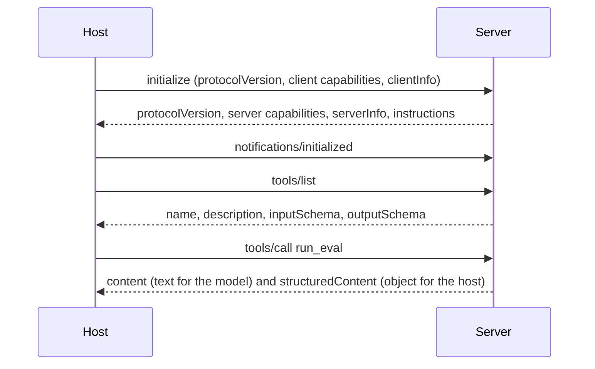

# MCP concepts, as this server uses them

This note is for reading the Invariant server with the protocol in view. The
spec is the authority ([modelcontextprotocol.io](https://modelcontextprotocol.io));
the Python SDK docs are the authority for the code
([py.sdk.modelcontextprotocol.io](https://py.sdk.modelcontextprotocol.io/)).
What follows is the part of that machinery you can see by running this project.

## Three primitives, three callers

A server exposes three kinds of thing. The difference is who decides to use it.

| Primitive | Who decides | Invariant example |
| --- | --- | --- |
| **Tool** | The model | `run_eval` executes a Holds suite because the model chose that call |
| **Resource** | The host application | `invariant://holds/report/artifacts/holds_report.json` is attached when the host wants the model to read a file |
| **Prompt** | The user | `gate_a_change` is a menu entry or slash command, not something the model invents |

A useful analogy, and then its limit: a resource is like `GET` (load data, change nothing) and a tool is like `POST` (do work, maybe write a report). A prompt has no HTTP twin. It is a saved message the user runs by name.

`list_scenarios` is a tool even though it mostly reads, because the model decides when the catalog matters. The same catalog is also the resource `invariant://maul/scenarios`, so a host can attach it without a tool call. Both are honest. They are not duplicates of the protocol; they serve different callers.

## What a session looks like

stdio and streamable HTTP carry the same messages. The session shape is:



`initialize` is a negotiation, not a ping.

- The client says which protocol revision it speaks and which optional features it can offer (roots, sampling, elicitation).
- The server answers with a revision it also speaks, plus the capabilities it actually implements, plus `serverInfo` and the `instructions` string.
- If the revisions cannot overlap, the server rejects the session. You do not discover that by calling a tool.
- The client then sends `notifications/initialized`. Requests before that are not part of a live session.

This server's capabilities are the ones the SDK advertises for the primitives it registered: tools, resources, and prompts. It does not implement sampling (the server asking the client's model to complete a prompt) or elicitation (the server asking the user a question mid-call). Those stay off unless a later change adds handlers.

After initialization the client discovers the surface:

1. `tools/list` returns each tool's name, description, JSON Schema for arguments (`inputSchema`), and, when the return type has one, `outputSchema`.
2. `resources/list` returns concrete resources. `resources/templates/list` returns URI templates such as `invariant://holds/report/{+path}`.
3. `prompts/list` returns prompt names and their arguments. Arguments are strings.
4. The model does not see this list as magic. The host turns `tools/list` into the tool definitions it would have sent to any tool-calling API. The description is the text the model reads to choose. That is why the descriptions in `src/invariant_mcp/tools.py` name Holds, Vigil, and Maul in the words a person would use.

`tools/call` carries the tool name and a JSON object of arguments. The SDK validates that object against the schema generated from the Python signature before the function runs. A bad argument is a tool error, not a crash.

## Tools and structured results

A tool result has two channels:

- `content` is text (or other content blocks) for the model.
- `structuredContent` is JSON for the application, validated against `outputSchema`.

Here the output schema is the function's return annotation. `run_eval` returns an `EvalRun` Pydantic model, so the host can read `threshold_passed` without parsing a paragraph. The model still receives the same object rendered as JSON text.

Returning a result is not the same as succeeding at the underlying job. `compare_baseline` returns `passed: false` when the regression gate fails. That is a completed call. `run_failure_probe` returns `status: "unavailable"` when the `maul` binary is missing. The call succeeded at telling the truth. Anticipated failures that should stop the model (a path that leaves the workspace, a suite file Holds rejects) are raised as tool errors. The client sets `isError` and the model sees the message, including a stable prefix such as `path_escape:`.

## Resources and the invariant:// scheme

Resources are addressed by URI. Templates use a subset of [RFC 6570](https://www.rfc-editor.org/rfc/rfc6570). `{+path}` is the reserved-expansion form, so a path may contain slashes: `artifacts/holds_report.json` is one parameter, not several.

| URI | Body |
| --- | --- |
| `invariant://workspace/index` | JSON list of artifact files the server discovered |
| `invariant://holds/report/{+path}` | Holds run report |
| `invariant://holds/baseline/{+path}` | Accepted Holds baseline |
| `invariant://vigil/policy/{+path}` | `vigil.yaml` |
| `invariant://vigil/events/{+path}` | Request JSONL for a dry-run |
| `invariant://vigil/decisions/{+path}` | Decision JSONL from a dry-run |
| `invariant://vigil/audit/{+path}` | Redacted audit JSONL |
| `invariant://maul/report/{+path}` | `reliability_report.json` |
| `invariant://maul/scenarios` | Compiled fault catalog |

The SDK rejects `..`, absolute paths, and NUL bytes in template parameters before the handler runs. The handler also calls `safe_join` against the workspace root, which resolves symlinks and rejects a link whose target leaves the root. A read of `invariant://holds/report/../secrets` does not open a file.

`resources/read` returns the file bytes as text, capped by `INVARIANT_MAX_RESOURCE_BYTES`. The index exists so a host does not have to guess filenames.

## Prompts

`prompts/get` takes a name and a string argument map and returns messages. This server returns one user message that names the tools to call and the paths to pass. `gate_a_change` sequences `run_eval` then `compare_baseline`. `investigate_failure` sequences `list_scenarios` then `run_failure_probe`.

The model does not call `prompts/get` on its own. A person picks the prompt from the host UI. The resulting messages are ordinary chat messages after that.

## Transports

The messages above do not change with the transport. The transport is only how the bytes move.

| Transport | How it runs here | When |
| --- | --- | --- |
| **stdio** | The host starts `invariant-mcp` and speaks JSON-RPC on stdin/stdout. Default. | Claude Desktop, Cursor, MCP Inspector |
| **streamable HTTP** | `--transport streamable-http` listens on `127.0.0.1:8000/mcp`. | A local client that connects by URL, or a second process you run yourself |

stdio has a sharp edge: **stdout is the wire**. Logs go to stderr. A `print()` in the server, or in a library imported at startup, corrupts the session. The Holds and Vigil libraries are imported for their APIs and do not write the protocol stream.

Streamable HTTP replaced the older HTTP+SSE transport. This server does not offer `--transport sse`. New clients should use streamable HTTP. `--json-response` makes each POST return one JSON body instead of an SSE response stream, which some clients want. `--stateless` drops session tracking. There is no authentication on the HTTP listener. Bind it to loopback unless you have put something else in front of it.

## What this server refuses to treat as a capability

MCP **roots** are directories the client claims are relevant. A confused or hostile client could advertise `/`. This server does not use roots as the sandbox. The operator sets `--workspace` / `INVARIANT_WORKSPACE` when the process starts, and every path the tools and resources touch is confined to that directory.

The instructions string on `initialize` tells the model which tool is which. It is not a policy engine. Vigil is the policy engine, and only for the files you point `check_policy` at. Nothing in this server promotes a Holds baseline or deploys a Vigil policy. Those stay human steps, matching Holds and Vigil themselves.

## Where the code sits

```text
cli.py            stdio or streamable HTTP
server.py         MCPServer, instructions, capability registration
tools.py          the five tools and the descriptions the model reads
resources.py      invariant:// templates and the index
prompts.py        gate_a_change, investigate_failure
adapters/holds.py RunService, CompareService
adapters/vigil.py ValidatePolicyService, DryRunService
adapters/maul.py  scenario catalog + `maul` argv (no Python API upstream)
safety/           workspace confinement, timed argv subprocesses
```

A tool function catches `InvariantError` and raises the SDK's `ToolError`. Anything else is an unexpected exception: the model sees a generic failure, and the traceback stays in the server log.

To watch a session, run the Inspector (`mcp dev` or `npx @modelcontextprotocol/inspector`) and look at `initialize`, then `tools/list`, then one `tools/call`. That is the whole lifecycle this server depends on.
